# EvoLab

EvoLab is a browser lab where you watch neural networks learn to play. Pick a concept (Pong, Snake, Flappy, a racing car, Tetris, a two-legged walker, or one you describe in a sentence), decide what counts as good and bad behaviour, choose a learning method (NEAT, DQN or PPO), and watch the network grow and improve generation by generation, at any speed from real time to flat out. Everything runs locally in your browser: there is no backend, no account and no telemetry.

**Live app: <https://laansdole.github.io/evolab/>**


## Gallery

| | |
|---|---|
| 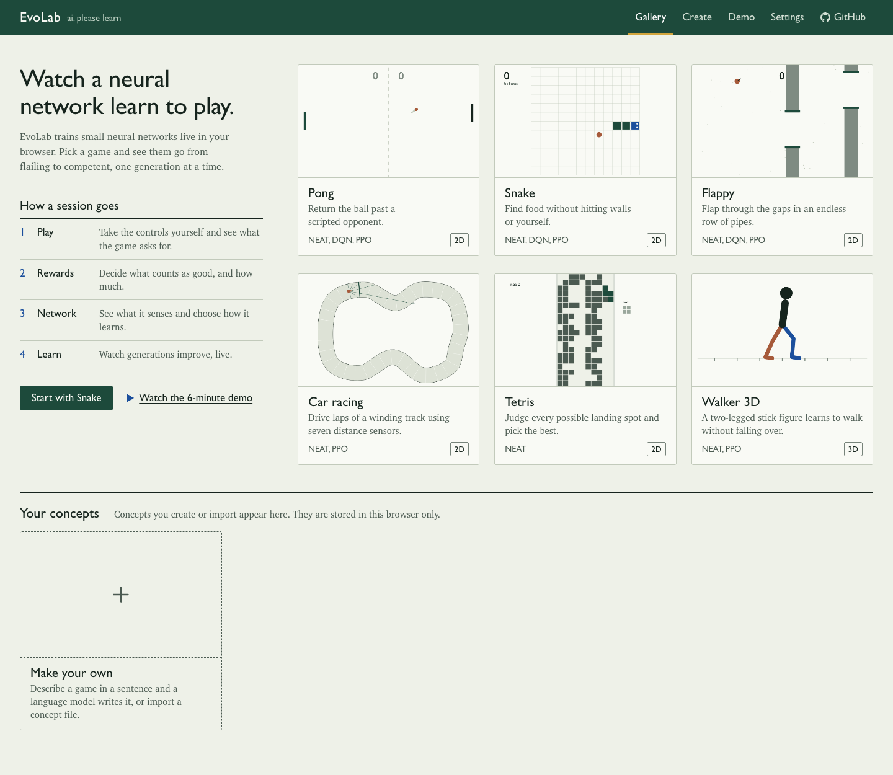 The gallery: six built-in concepts and the box that creates new ones from text. | 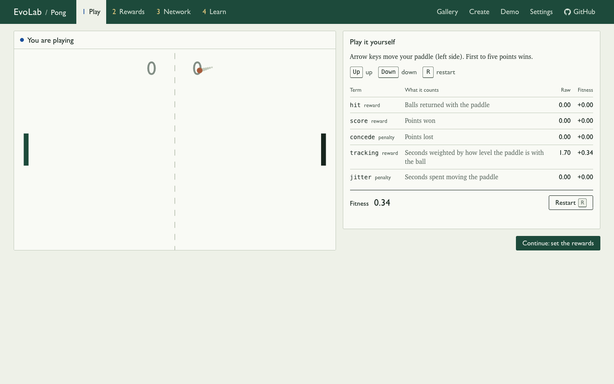 Step 1: play it yourself and see every reward term count up. |
| 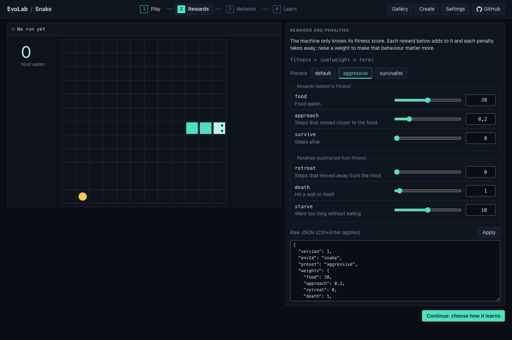 Step 2: rewards and penalties as sliders, presets or raw JSON. | 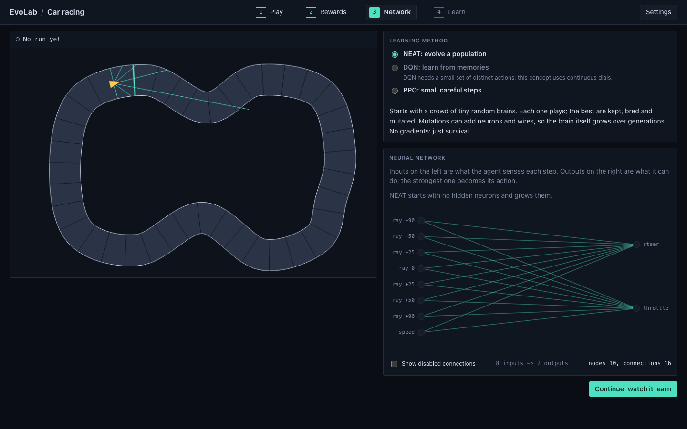 Step 3: choose a learning method; ones that cannot work say why. |
| 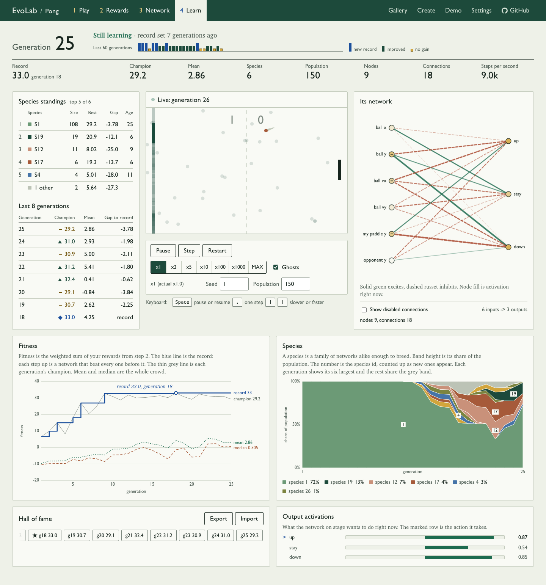 Pong with NEAT: the live population drawn as ghosts. | 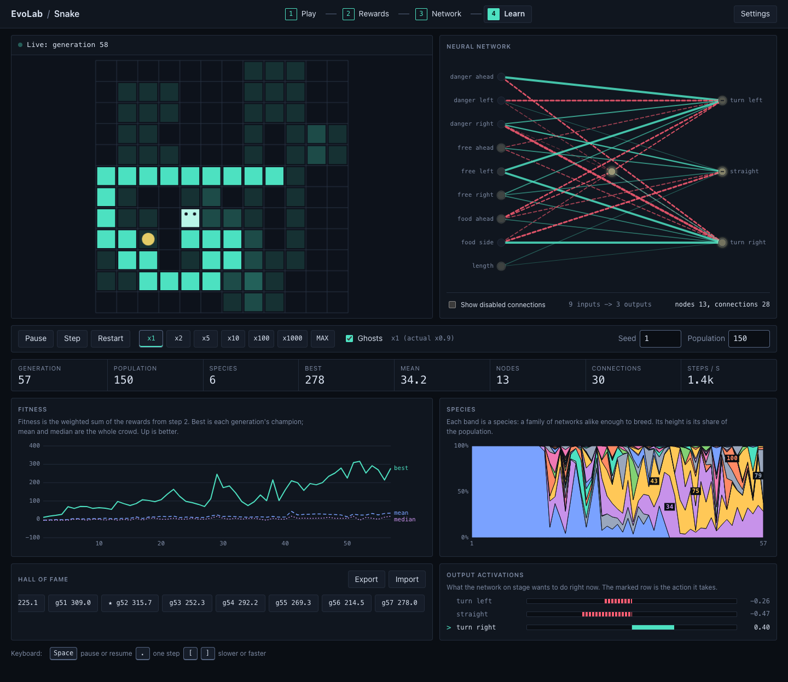 Snake with NEAT. |
| 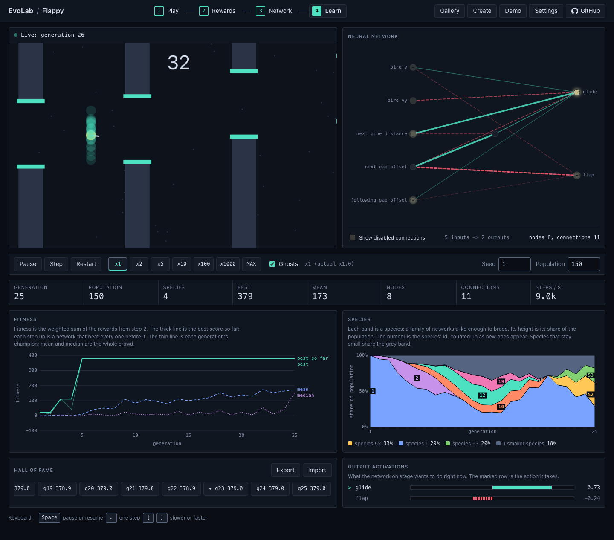 Flappy at x1: a whole generation flying at once. | 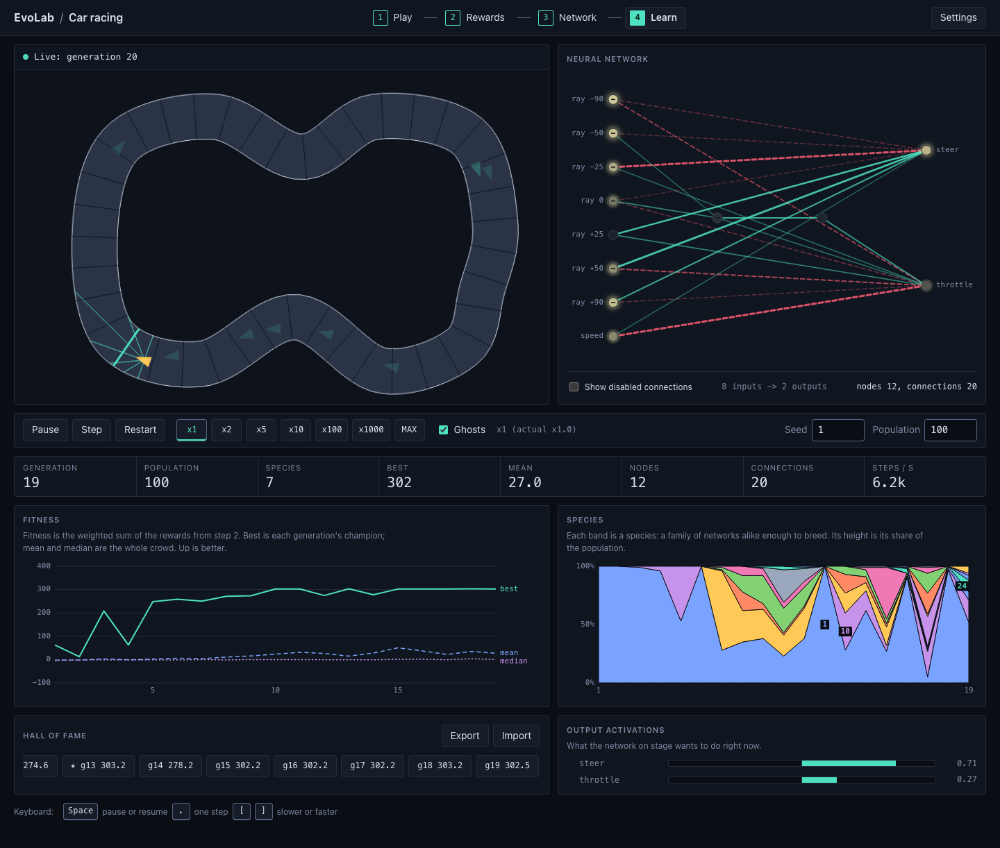 Car racing: seven distance sensors, steering and throttle. |
| 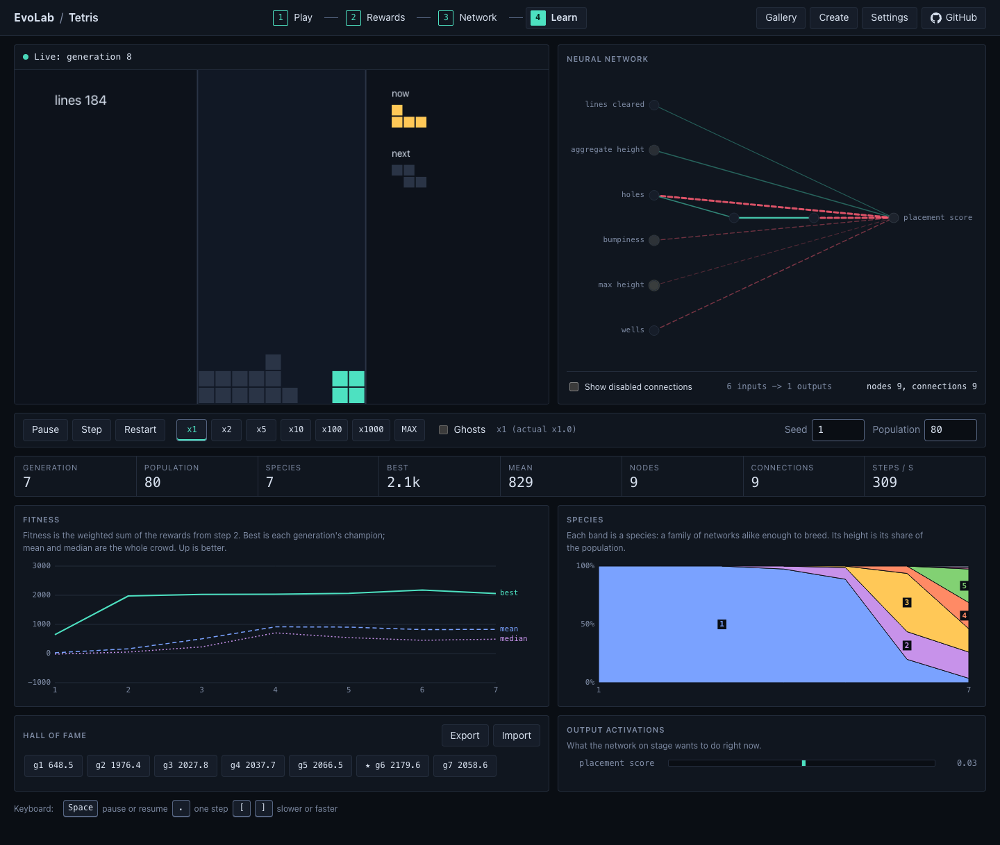 Tetris: the network scores every possible landing spot. | 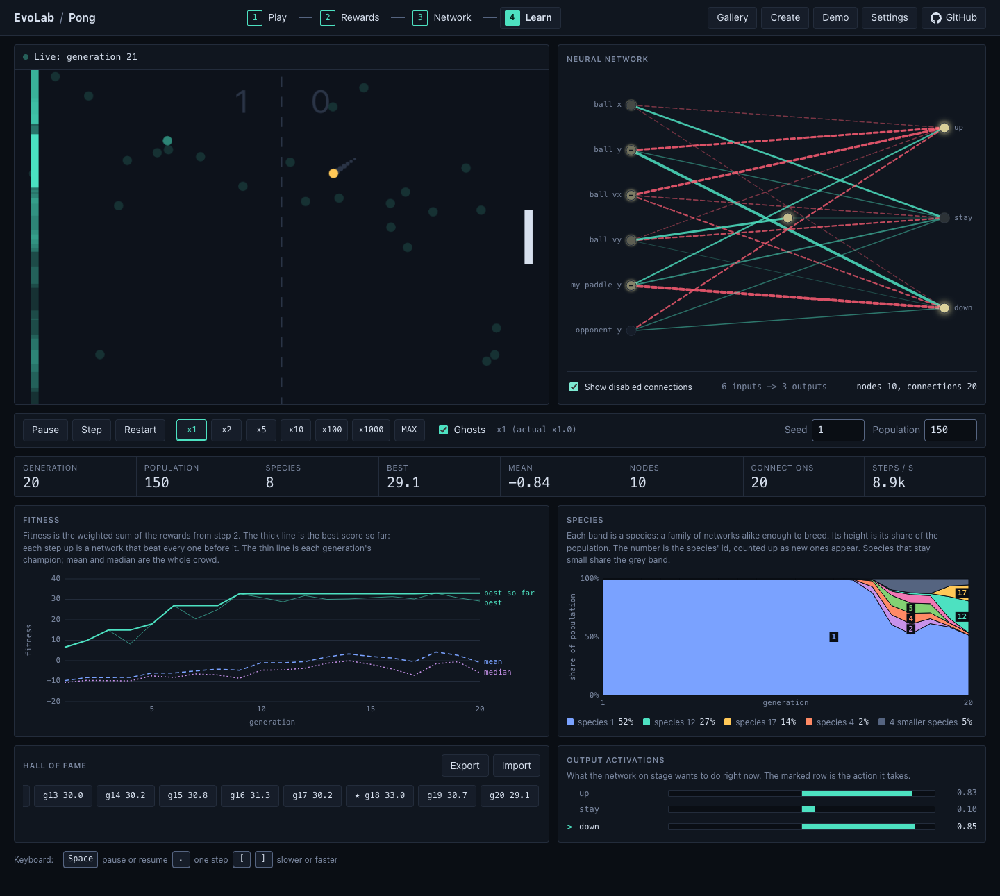 The champion's network, with disabled connections shown. |
| 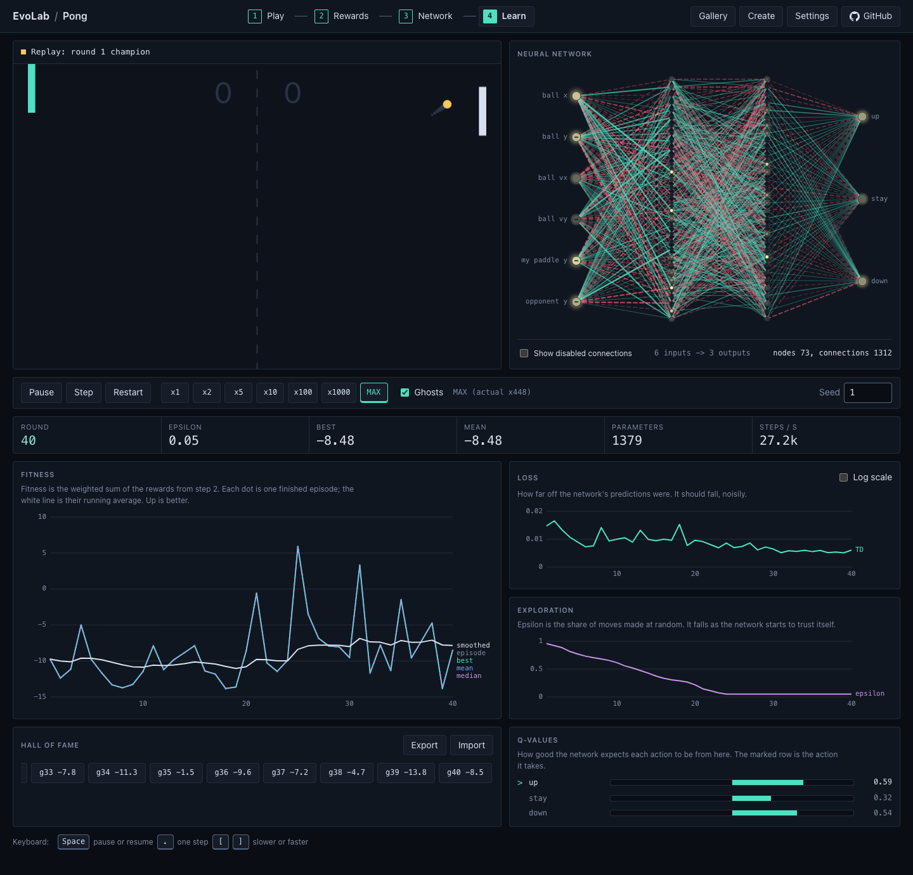 DQN on Pong: loss, epsilon and Q-values. |  PPO on the car: policy and value loss, entropy, action means. |
| 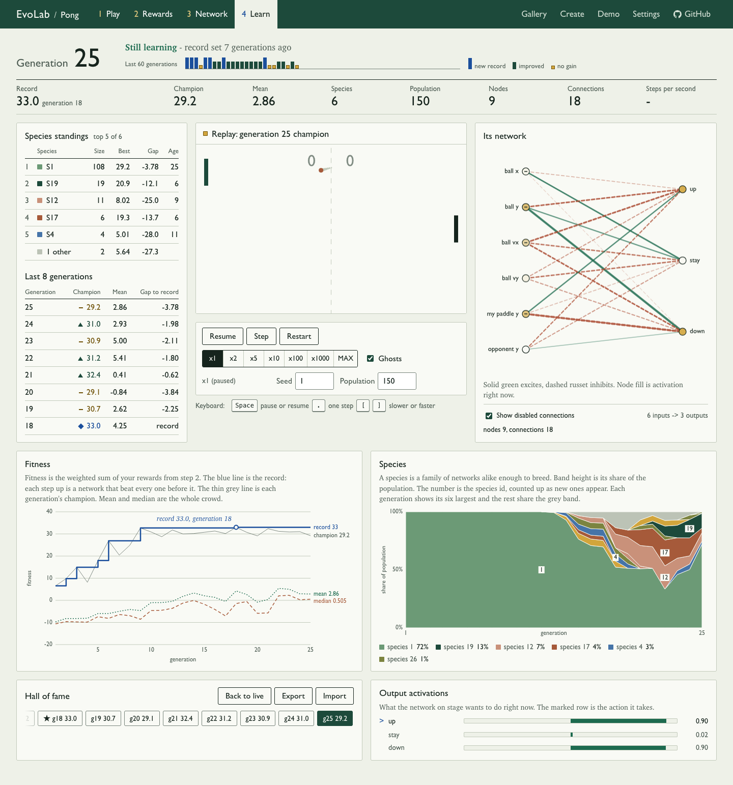 The hall of fame replays any earlier champion. |  A concept generated from text, training like a built-in. |
| 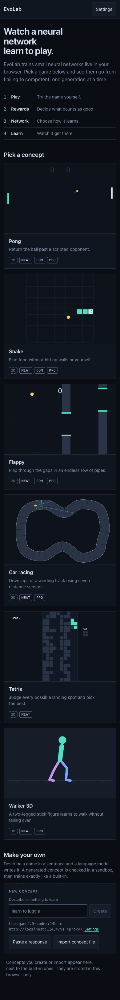 The gallery at 390 px. | 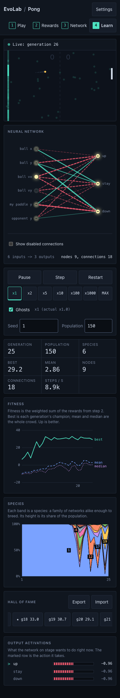 The Learn step at 390 px: every panel, one column. |

## Run it

You need Node 22.

```bash
npm install
npm run dev
```

Open the URL it prints. For the production build use `npm run build && npm run preview`.

The built app is plain static files (`dist/`) and works from any static host, including a sub-path: `EVOLAB_BASE=/evolab/ npm run build` is how the live site is built. One feature behaves differently there. Under `npm run dev` and `npm run preview` a small Vite plugin proxies requests to your LLM server, so the concept generator works with no server-side setup. A static host has no proxy, so the page calls your LLM server directly and that server has to allow the page's origin (see [Concept from text](#concept-from-text)).

## The journey

1. **Pick a concept** in the gallery.
2. **Play** it yourself. The table next to the game shows every reward term counting up as you play, so you see exactly what the machine will be scored on.
3. **Shape the reward.** Each term has a weight: drag a slider, pick a preset (default, aggressive, survivalist) or edit the JSON. Changes apply to a running session from the next generation and leave a marker on the fitness chart.
4. **See the network and pick a method.** Inputs on the left are what the agent senses, outputs on the right are what it can do. Choose NEAT, DQN or PPO; a method that cannot learn the concept is disabled and says why.
5. **Watch it learn.** The stage shows the population (or the single agent) live; charts track fitness, species or loss and exploration; the network redraws as it changes; every generation's champion lands in the hall of fame, where a click replays it and Export saves it as a JSON file that Import loads back.

Speed is a ladder: x1, x2, x5, x10, x100, x1000 and MAX. Up to x1000 the stage shows the training itself, skipping frames as needed; at MAX nothing is drawn while training and the stage replays each new champion instead. Speed never changes what is computed, only how fast: the same seed gives the same run at every speed. Pause with Space, finish one iteration with `.`, and move along the ladder with `[` and `]`.

## Learning methods

**NEAT** (NeuroEvolution of Augmenting Topologies) starts with a crowd of tiny random networks that have no hidden neurons. Each one plays; the best are kept, bred and mutated. Mutations can add neurons and connections, so the network itself grows over generations. Similar networks are grouped into species that compete mostly among themselves, which protects new ideas until they have had time to improve. There are no gradients, only selection.

**DQN** (Deep Q-Network) trains one fixed-shape network from its own memories. It plays, stores every moment in a replay buffer, and repeatedly nudges its estimate of "how good is each action here" toward what actually happened next. It starts by acting randomly (epsilon) and gradually trusts itself. It needs a small set of distinct actions.

**PPO** (Proximal Policy Optimization) trains one fixed-shape network that plays several copies of the game at once, then looks back over the batch and makes the better-than-expected actions more likely, in small clipped steps so that it does not forget what it knew. It works for buttons and for smooth controls such as steering or joint motors.

All three are written from scratch in TypeScript in this repository (`src/neat`, `src/nn`, `src/rl`); there is no ML library.

| Concept | Actions | NEAT | DQN | PPO |
|---|---|---|---|---|
| Pong | 3 buttons | yes | yes | yes |
| Snake | 3 buttons | yes | yes | yes |
| Flappy | 2 buttons | yes | yes | yes |
| Car racing | steer and throttle (continuous) | yes | no: needs distinct actions | yes |
| Tetris | scores candidate placements | yes | no | no |
| Walker 3D | six joint targets (continuous) | yes | no: needs distinct actions | yes |
| Generated concepts | buttons or continuous | yes | buttons only | yes |

## Benchmarks

Every built-in concept has a headless learning benchmark with a fixed seed that fails if learning stops working (`npm run bench`). Measured on an Apple Silicon laptop; `gen1` is the best fitness of the first generation, `last5` the best over the final five.

| Benchmark | Iterations | Start | End | Seconds |
|---|---|---|---|---|
| NEAT Pong | 30 generations | gen1 6.54 | last5 33.72 | 3.4 |
| NEAT Snake | 40 generations | gen1 11.05 | last5 215.05 | 0.3 |
| NEAT Flappy | 40 generations | gen1 23.55 | last5 378.99 | 2.5 |
| NEAT Car | 30 generations | gen1 62.39 | last5 319.51 (champion drives 5 laps) | 9.5 |
| NEAT Tetris | 15 generations | gen1 648.45 | last5 2429.40 | 2.4 |
| NEAT Walker | 40 generations | gen1 2.37 | last5 275.46 (champion walks 27 m in 15 s) | 25.3 |
| DQN Pong | 160,000 steps | first 20% of episodes: mean -10.61 | last 20%: mean 11.81 | 6.1 |
| PPO Car | 150 updates | first 10 updates: mean -2.32 | last 10: mean 106.62 | 7.0 |

The full table, the assertions, the throughput guards and every deviation from the original design are in [docs/benchmarks.md](docs/benchmarks.md).

## Concept from text

Type a sentence such as "balance a pole on a cart" into the box in the gallery. EvoLab asks a language model for two things: a JSON description (observations, actions, reward terms, presets, keys) and one JavaScript function that implements the environment. The result is checked by a validator that actually runs it: sizes and ranges of observations, determinism under a seed, reward terms that actually move, episodes that do not end at once, a render that draws. If the check fails, the precise errors go back to the model, up to three times ("repairing 1/3"). Only a module that passes is added to your gallery.

EvoLab is an experimental project and the sandbox this code runs in is best-effort, not a security boundary: only generate, import or load concepts from sources you trust.

**Settings.** Open Settings and enter any OpenAI-compatible endpoint: Ollama (`http://localhost:11434/v1`), LM Studio (`http://localhost:1234/v1`) or a remote one with an API key. The only things sent are your concept text and EvoLab's fixed prompt, and only to that endpoint. A non-local address shows a warning.

**On the live site** (or any static hosting) there is no proxy, so the page calls your LLM server straight from the browser and the server must allow the site's origin:

- Ollama: `OLLAMA_ORIGINS=https://laansdole.github.io ollama serve`
- LM Studio: Developer > Local Server > enable CORS
- OpenAI (`https://api.openai.com/v1`): works as is. The API allows browser requests from any origin, so direct mode needs no setup beyond your own API key, which is stored only in your browser and sent only to OpenAI.

**No LLM server at all?** Use "Paste a response": copy the prompt, paste it into any chat model, and paste the answer back. It goes through the same validator. This works everywhere, including the live site.

**Where concepts live.** Generated concepts are stored in your browser's IndexedDB, not on any server. Each card has View source, Export (a `.evolab-concept.json` file you can import elsewhere) and Delete.

Generated concepts are 2D with button or continuous actions; they can be trained with NEAT and PPO, and with DQN when they use buttons.

**Tested with** OpenAI `gpt-6-luna`: 5 of 5 concepts passed the validator on the first answer, with no repairs. The numbers, the history of runs and the generated modules (importable `.evolab-concept.json` files) are in [docs/llm-trial/RESULTS.md](docs/llm-trial/RESULTS.md); `npm run llm-trial` repeats the trial with your own key.

## Sandbox and its limits

Generated code never runs on the page. It runs only inside Web Workers, behind five layers:

1. **Static scan.** Before anything executes, the source is rejected if it mentions anything it has no business using: `import`, `eval`, `fetch`, `WebSocket`, `self`, `globalThis`, `postMessage`, timers, `Date`, `Math.random`, prototype access, template literals, and more.
2. **Lockdown.** The worker replaces its network and storage APIs (`fetch`, `XMLHttpRequest`, `WebSocket`, `indexedDB`, `caches`, `importScripts` and others) with functions that throw.
3. **Scoped evaluation.** The module is compiled in strict mode with all of those names, plus `self`, `globalThis` and the timers, shadowed by `undefined`.
4. **Content Security Policy.** The dev and preview servers send a policy that only allows connections to the app's own origin, so code that somehow escaped layers 1 to 3 still could not reach another site.
5. **Watchdog.** The validator's worker is killed after 5 seconds without an answer, and a training worker that goes silent for 15 seconds is terminated.

Rendering leaves the sandbox only as a list of drawing commands, which the page paints.

Be clear about what this is. Generated code is untrusted, and these layers are built to contain mistakes and casual misuse by a model you chose, not to stop a determined attacker. A hostile module can still burn CPU until the watchdog stops it. On static hosting the page's policy has to allow connections to your LLM endpoint, so layer 4 is weaker there and layers 1 to 3 carry the weight. Do not paste modules from sources you do not trust into a browser profile that can reach other services on localhost.

## Add a new concept in one file

A concept is one TypeScript file that exports an `EnvDefinition`. The reference is `src/envs/reach1d.ts` (a dot that learns to slide onto a target; registered but hidden from the gallery).

1. Copy `src/envs/reach1d.ts` to `src/envs/<name>.ts`.
2. Fill in the definition:
   - `meta`: id, name, tagline, `dims` (`'2d'`), `fps`, `maxSteps`, which `learners` can train it, whether it can draw `ghosts`.
   - `observation.labels`: one label per number the network sees.
   - `action`: `discrete` (button labels) or `continuous` (dial labels, each in -1..1).
   - `rewardTerms`: raw counters such as "food eaten" or "seconds alive". Weights are non-negative; the sign comes from `kind` (`reward` adds, `penalty` subtracts).
   - `presets`: named weight sets; the first must be `default` and equal the default weights.
   - `human`: the keys for step 1, and `humanAct` in the env to turn held keys into an action.
   - `create()`: returns one env instance; many run side by side, so all state lives in the closure.
3. Keep to the `Env` contract:
   - deterministic per seed: all randomness comes from `Rng` seeded in `reset`; no `Math.random`, no clock;
   - no allocation in `step` or `observe` (reuse typed arrays): they run millions of times;
   - `done` is false after `reset`; `step` updates the raw `terms`, never weights;
   - `render` draws on an 800 x 500 logical canvas and clears first, unless `view.ghost` is set, in which case it draws only the agent.
4. Register it with one line in `src/envs/index.ts`.
5. Run `npm test`. The conformance suite (`src/env/conformance.ts`) checks every registered env automatically: observation sizes and ranges, determinism, reward terms that move, rendering, `humanAct`.
6. Add a learning benchmark in `tests/bench/` with `benchNeat` from `tests/bench/helpers.ts` (five lines; see `tests/bench/pong.bench.test.ts`).

The complete worked example, `src/envs/reach1d.ts`:

```ts
import { Rng } from '../core/rng';
import { clamp } from '../core/math';
import type { Env, EnvDefinition, HumanInput, RenderView } from '../env/types';

// 1. Constants of your world.
const STEPS = 120, MOVE = 0.05;

function create(): Env {
  // 2. All state lives in this closure. Many instances run side by side.
  let x = 0, target = 0, t = 0, done = false;
  const terms = new Float32Array(3);          // same order as rewardTerms below: closeness, arrived, effort
  const obs = new Float32Array(2);            // same order as observation.labels
  return {
    // 3. reset: all randomness comes from the seed.
    reset(seed) {
      const rng = new Rng(seed);
      x = 0; target = rng.range(0.2, 0.9) * (rng.next() < 0.5 ? -1 : 1);
      t = 0; done = false; terms.fill(0);
    },
    // 4. step: apply the action, update raw reward-term counters (never weights), decide if the episode is over.
    step(action) {
      if (done) return;
      const move = (action as number) - 1;    // 0 left, 1 stay, 2 right
      x = clamp(x + move * MOVE, -1, 1);
      const d = Math.abs(target - x);
      terms[0]! += Math.max(0, 1 - d) / STEPS;
      if (d < 0.05) terms[1]! += 1 / STEPS;
      if (move !== 0) terms[2]! += 1 / STEPS;
      if (++t >= STEPS) done = true;
    },
    // 5. observe: numbers the network sees, scaled to about [-1, 1].
    observe() { obs[0] = x; obs[1] = target; return obs; },
    get done() { return done; },
    terms,
    // 6. render: 800 x 500 logical canvas. With view.ghost draw only the agent (no clear, no background).
    render(view: RenderView) {
      if (view.kind !== '2d') return;
      const d = view.draw, px = (v: number) => 400 + v * 340;
      if (!view.ghost) {
        d.clear('#0d121b');
        d.line(60, 250, 740, 250, '#2a3446', 2);
        d.circle(px(target), 250, 16, '#2a3446'); d.circle(px(target), 250, 10, '#82d173');
      }
      d.circle(px(x), 250, 8, '#4de1c1');
    },
    // 7. humanAct: translate held keys into the same action shape step() takes.
    humanAct(input: HumanInput) { return input.held.has('ArrowLeft') ? 0 : input.held.has('ArrowRight') ? 2 : 1; },
  };
}

export const reach1d: EnvDefinition = {
  meta: {
    id: 'reach1d', name: 'Reach the Target', tagline: 'Slide the dot onto the target.',
    description: 'A dot on a rail must move onto a target and stay there. The simplest thing a network can learn.',
    dims: '2d', fps: 30, maxSteps: STEPS, learners: ['neat', 'dqn', 'ppo'], ghosts: true, hidden: true,
  },
  observation: { labels: ['dot x', 'target x'] },
  action: { type: 'discrete', labels: ['left', 'stay', 'right'] },
  rewardTerms: [
    { key: 'closeness', kind: 'reward', description: 'Average closeness to the target over the episode (0 to 1)', defaultWeight: 10 },
    { key: 'arrived', kind: 'reward', description: 'Fraction of the episode spent on the target', defaultWeight: 5 },
    { key: 'effort', kind: 'penalty', description: 'Fraction of steps spent moving', defaultWeight: 0.5 },
  ],
  presets: [
    { name: 'default', description: 'Get close, then stay.', weights: { closeness: 10, arrived: 5, effort: 0.5 } },
    { name: 'aggressive', description: 'Only arriving matters.', weights: { closeness: 5, arrived: 15, effort: 0 } },
    { name: 'survivalist', description: 'Move as little as possible.', weights: { closeness: 10, arrived: 2, effort: 3 } },
  ],
  human: { hint: 'Arrow keys move the dot.', keys: [{ code: 'ArrowLeft', label: 'left' }, { code: 'ArrowRight', label: 'right' }] },
  // ppo gamma: the observation has no clock, so the value net cannot predict a long-horizon return and the advantages get noisy.
  train: { neat: { populationSize: 50, episodesPerGenome: 4 }, ppo: { gamma: 0.95 } },
  create,
};
```

## Tests

| Command | What it proves |
|---|---|
| `npm test` | Unit tests (under a minute): seeded RNG, reward engine, every env's conformance and determinism, NEAT operators and XOR, gradient checks of the hand-written backprop, DQN and PPO on toy problems, the sandbox and validator, persistence. |
| `npm run bench` | The learning benchmarks above: each method really learns each concept from a fixed seed. |
| `npm run perf` | Throughput floors for the training hot paths (generations per minute per concept, MLP and NEAT network speed). |
| `npm run e2e` | Playwright in Chromium: the full journey for all six concepts, DQN and PPO, live reward edits, champion export and import, concept from text against a fake LLM, UI responsiveness at MAX, and the GitHub Pages build served from a plain static server under `/evolab/`. |
| `npm run build` | Strict type check and the production bundle. |

`EVOLAB_SCREENSHOTS=1 npm run e2e -- screenshots` regenerates the images in `docs/screenshots/`. Measured numbers are in [docs/benchmarks.md](docs/benchmarks.md).

## Project layout

| Path | What lives there |
|---|---|
| `src/core` | Seeded random numbers and small math helpers. |
| `src/env` | The Env SDK: types, registry, reward engine, drawing-command recorder, conformance suite. |
| `src/envs` | The built-in concepts, one file or folder each. |
| `src/neat` | NEAT: genomes, innovation numbers, mutation, crossover, speciation, reproduction. |
| `src/nn` | A small MLP with manual backprop, Adam and the DQN/PPO losses. |
| `src/rl` | Replay buffer, DQN agent, GAE, PPO agent. |
| `src/learner` | One tick-based `Learner` interface over NEAT, DQN and PPO, so speed control is only a scheduler. |
| `src/trainer` | The Web Worker, its message protocol, the speed scheduler, and the headless runner used by tests. |
| `src/gen` | Concept from text: prompt, parser, static scan, sandbox, validator, repair loop, IndexedDB library. |
| `src/persist` | localStorage preferences and champion export/import. |
| `src/viz` | Hand-drawn Canvas2D charts and the network graph. |
| `src/three` | The three.js stage for 3D concepts (loaded only when one is opened). |
| `src/ui` | Pages, panels, router and styles in plain TypeScript; no framework. |
| `tools/llmProxy.ts` | The Vite plugin that proxies LLM requests under dev and preview. |
| `tests/bench`, `tests/perf`, `tests/e2e` | Learning benchmarks, throughput guards, Playwright suites. |
| `docs/benchmarks.md`, `docs/screenshots` | Measured numbers and the images on this page. |

Runtime dependencies are `three` (3D view) and `@dimforge/rapier3d-compat` (walker physics). Nothing else.

## Out of scope

Not in this version: generated 3D or physics-engine concepts; generated concepts with candidate-placement actions; multi-agent self-play; GPU or WebGPU training; recurrent NEAT links and activation-function mutation; free (non-planar) walker balance and walker arms; DQN for Tetris or for continuous actions; prioritised replay, dueling networks, observation normalisation; resumable training runs and a persisted hall of fame; side-by-side comparison of generations; streaming LLM responses; a hyperparameter editor beyond seed and population; layouts below 900 px; translations; accounts, sharing or cloud sync; a hosted LLM proxy for the static site.

## License

[MIT](LICENSE), copyright (c) 2026 Do Le Long An.
