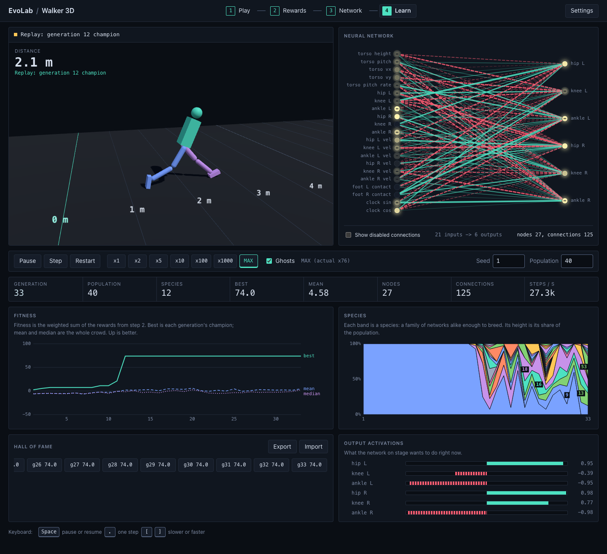

# EvoLab

Watch neural networks learn to play games in your browser, with no backend and no account.

**Live app** at <https://laansdole.github.io/evolab/>



## What it does

- **Six games.** Pong, Snake, Flappy, a racing car, Tetris and a two-legged 3D walker.
- **Three learning methods.** NEAT, DQN and PPO are written from scratch in TypeScript, with no ML library.
- **Make your own.** Describe a game in a sentence on the [Create](https://laansdole.github.io/evolab/create) page. An LLM writes it, a sandboxed validator runs it, and then it trains like a built-in game.
- **You set the reward.** Play the game yourself, weight each reward and penalty, then watch the network, the charts and the population change as it learns, at any speed from real time to flat out.

Each page has its own address, such as [/evolab/pong](https://laansdole.github.io/evolab/pong) or [/evolab/settings](https://laansdole.github.io/evolab/settings).

## Quick start

You need Node 22.

```bash
npm install
npm run dev      # open the URL it prints
npm test         # unit tests
npm run e2e      # Playwright, full journey in Chromium
npm run build    # type check and production bundle in dist/
EVOLAB_BASE=/evolab/ EVOLAB_STATIC=1 npm run build   # the GitHub Pages build
```

`npm run bench` runs the learning benchmarks. The measured numbers are in [docs/benchmarks.md](docs/benchmarks.md).

## LLM setup

Open Settings and pick a provider. The base URL and the model stay editable.

- **OpenAI** is the default. It needs your API key, which is stored only in your browser and sent only to OpenAI.
- **LM Studio** needs no key. Start its local server and enable CORS.
- **Ollama** needs no key. On the live site, start it with `OLLAMA_ORIGINS=https://laansdole.github.io ollama serve`.

Generated code runs in a best-effort sandbox that is not a security boundary, so only generate or import games from sources you trust. Trial results for generated games are in [docs/llm-trial/RESULTS.md](docs/llm-trial/RESULTS.md).

## Keyboard

In "Play it yourself" the arrow keys control the game and R restarts it. The hint under each game lists any other keys it uses.

## More detail

- [docs/benchmarks.md](docs/benchmarks.md) has the benchmark table, the throughput floors and the changes from the original design.
- [docs/llm-trial/RESULTS.md](docs/llm-trial/RESULTS.md) has the text-to-game trials and the generated modules.
- [src/envs/reach1d.ts](src/envs/reach1d.ts) is a commented one-file example of a game. Copy it to add your own.
- [docs/screenshots](docs/screenshots) holds a picture of every step. `EVOLAB_SCREENSHOTS=1 npm run e2e -- screenshots` regenerates them.

## Inspiration and credits

- [Code Bullet](https://www.youtube.com/@CodeBullet) made the "AI learns to play X" videos that inspired this project.
- [ml-visualized.com](https://ml-visualized.com/) inspired showing the network as it learns.
- The walker's awkward manual controls follow [QWOP](https://www.foddy.net/Athletics.html) by Bennett Foddy.

Papers behind the methods.

- NEAT. K. O. Stanley and R. Miikkulainen, "Evolving Neural Networks through Augmenting Topologies", Evolutionary Computation 10(2), 2002.
- DQN. V. Mnih et al., "Human-level control through deep reinforcement learning", Nature 518, 2015.
- Double DQN targets. H. van Hasselt, A. Guez and D. Silver, "Deep Reinforcement Learning with Double Q-learning", AAAI 2016.
- PPO. J. Schulman et al., "Proximal Policy Optimization Algorithms", arXiv:1707.06347, 2017.
- GAE. J. Schulman et al., "High-Dimensional Continuous Control Using Generalized Advantage Estimation", arXiv:1506.02438, 2015.
- Adam. D. P. Kingma and J. Ba, "Adam: A Method for Stochastic Optimization", arXiv:1412.6980, 2014.
- The seeded random number generator is mulberry32 by Tommy Ettinger.

Runtime libraries.

- [three.js](https://threejs.org/) draws the 3D view (MIT).
- [Rapier](https://rapier.rs/), as `@dimforge/rapier3d-compat`, runs the walker physics (Apache-2.0).

## License

[MIT](LICENSE), copyright (c) 2026 Do Le Long An.
