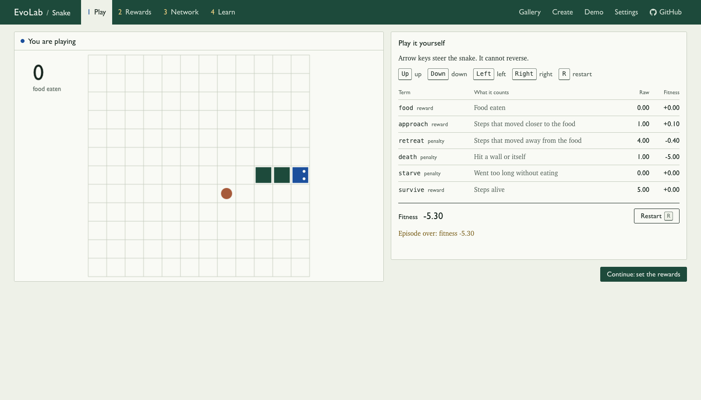
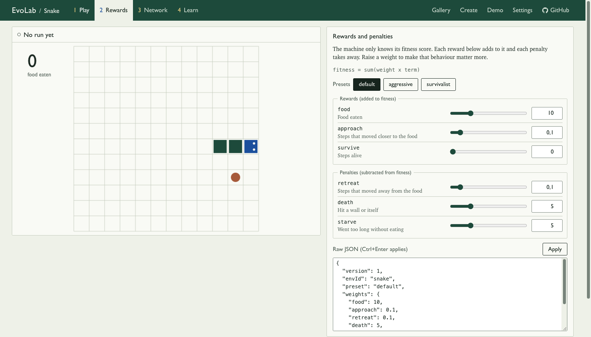
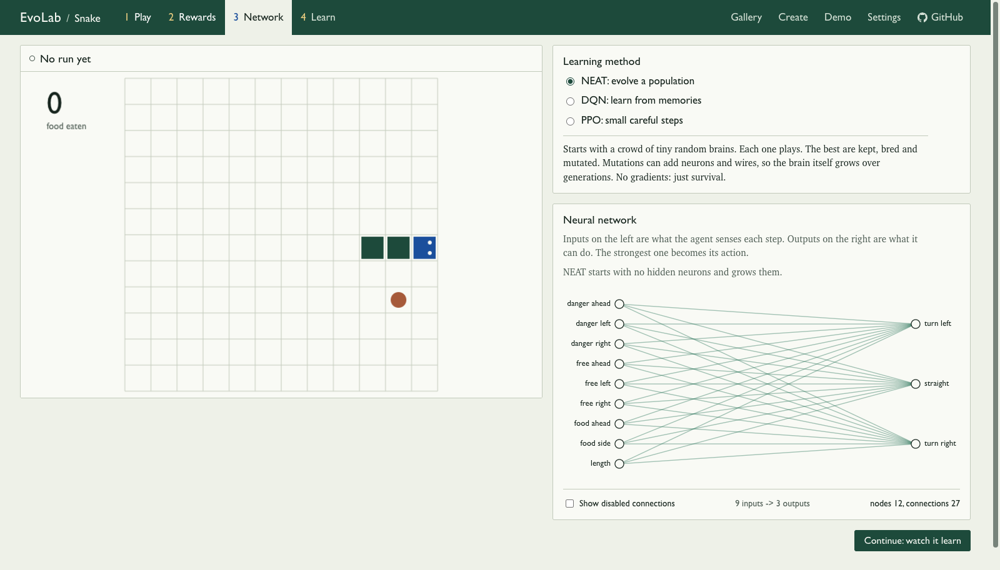
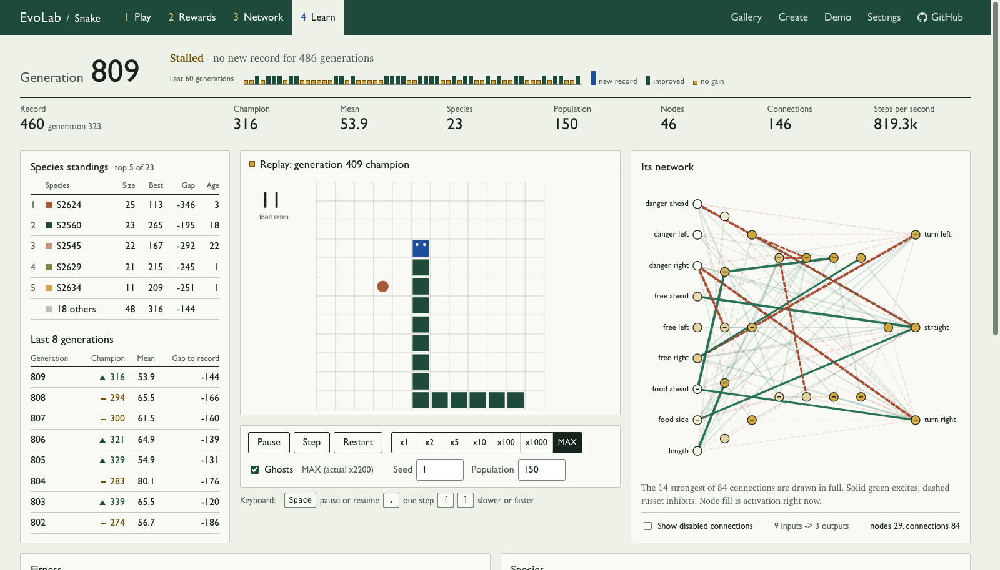
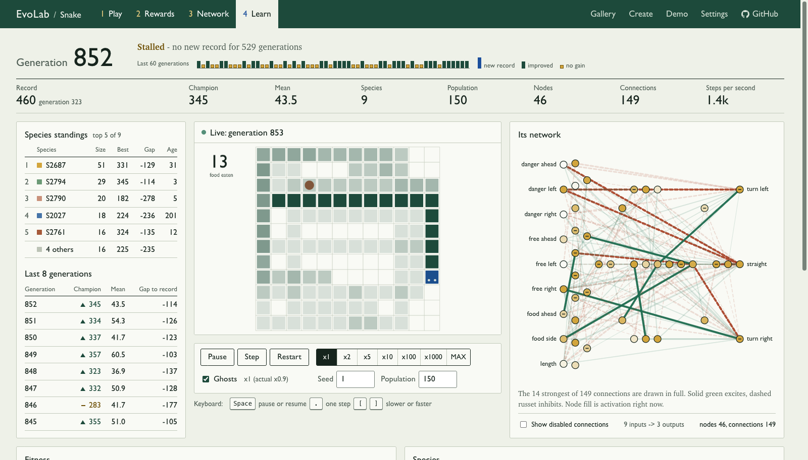
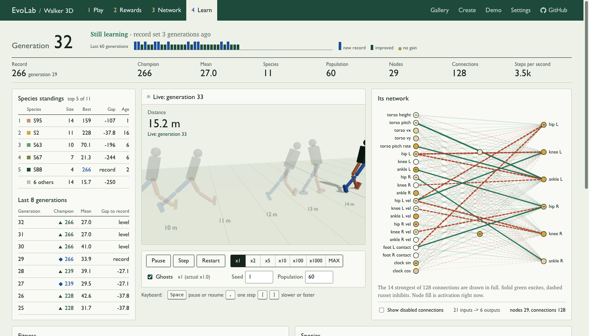
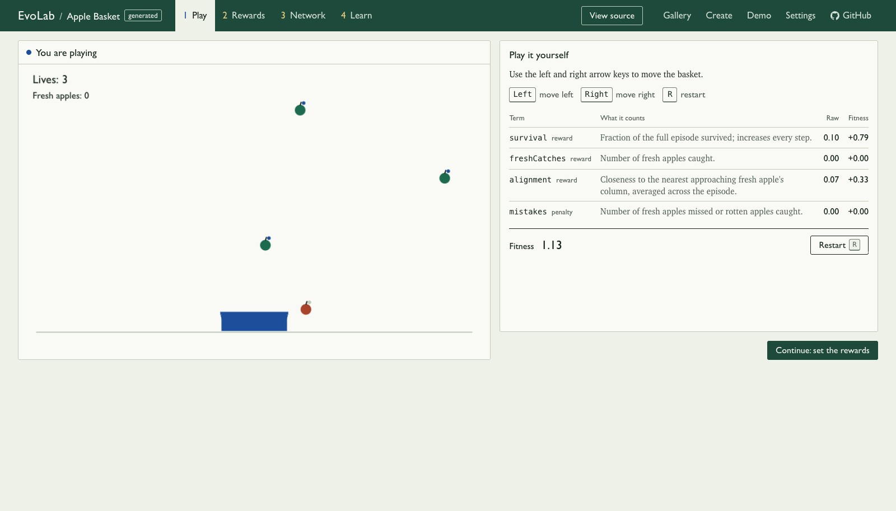

# Demo runbook

This runbook replays the demo video: a fresh browser on the live site plays Snake, sets the rewards, watches NEAT and DQN learn it, watches a 3D walker learn to walk, and has OpenAI `gpt-6-luna` write a new game from one sentence that NEAT then trains. Every screenshot and the video come from one real run on 2026-11-22 at commit `935c123` (the Field guide redesign). Idle stretches longer than 2.5 s are shortened in the video. Nothing else is cut.

Watch it: <https://laansdole.github.io/ai-please-learn/demo/> (or open `demo.html` in this folder). Time: about 5 minutes. The Create step needs one to two minutes for the LLM.

## 1. Prerequisites

- A desktop browser (the recording used Google Chrome, headless, 1600 x 1000).
- For step 9 only: an OpenAI API key, or a local model in LM Studio or Ollama. Nothing else is needed for steps 1 to 7.
- To run locally instead of the live site: Node 22, then `npm install` and `npm run dev` (see [DEVELOPER.md](../../../DEVELOPER.md)).

## 2. Open the app

Open <https://laansdole.github.io/ai-please-learn/>. The gallery lists six built-in games as plates, with the four steps of a session beside them: Play, Rewards, Network, Learn.

## 3. Play it yourself (Snake)

1. Click **Snake**. Step 1 opens with you in control and the reward table on the right.
2. Steer with the arrow keys. In the recording the snake hits the wall almost at once: fitness -5.30, "Episode over".
3. Press **R** to restart.

## 4. Set the rewards and the method

1. Click **2 Rewards**. Each term (food, approach, retreat, death, starve, survive) has a weight. The fitness is their weighted sum.
2. Click **3 Network** and keep **NEAT**.

## 5. Watch NEAT learn

1. Click **4 Learn**, then **Start**, then **MAX**.
2. Read the header: the generation, a verdict ("Still learning" or "Stalled"), the last 60 generations as marks (blue = new record, green = improved, ochre = no gain), and the record with the generation that set it.
3. Click **x1** to watch the current champion play at normal speed.

What to look for:

- Generation 379: record 460, set at generation 323.
- Generation 790: the record is still 460 and the header says "Stalled - no new record". The run found a good snake early and then plateaued, and the app says so.
- Generation 852 (at 1x): champion 345, network of 46 nodes and 149 connections.

## 6. Same game with DQN

1. Open **3 Network**, choose **DQN**, then **4 Learn**, **Start**, **MAX**.

What to look for: round 370 with record 368 (set at round 352) and mean 171. Round 621 with record 383 (round 424). The network is fixed (1475 parameters) and exploration (epsilon) is at 0.05. For DQN the verdict reads the smoothed average, since single rounds are noisy.

## 7. The 3D walker

1. Open **3D walker**, go to **4 Learn**, **Start**, **MAX**. Then **x1** to watch the champion.

What to look for: generation 15 with record 221 (generation 11) and mean 24.1. Generation 29 with record 266 and the verdict "Still learning - record set 1 generation ago".

## 8. Settings

1. Click **Settings**. OpenAI is the default provider with model `gpt-6-luna`. LM Studio and Ollama are the other two buttons.
2. Paste your API key. It is masked, stored only in this browser and sent only to `api.openai.com`.

## 9. Make your own game

1. Click **Create** and type a sentence. The recording used "catch apples in a basket".
2. Click **Create**. The model writes the game. The app validates it in a sandbox, including a check that random play scores clearly worse than good play.
3. The new game opens on its own page (here after 75 s) and plays like a built-in one.

## 10. Train the generated game

1. Go to **4 Learn**, **Start**, **MAX**.

What to look for: record 19.9 at generation 159, still the record at generation 525 (mean -4.25). The header shows "Stalled". This generated game plateaus quickly.

## Variance

Generated games differ from run to run. Three real runs of step 9 with the same sentence:

| Run | Commit | Time to generate | Game | NEAT result |
|---|---|---|---|---|
| Dry run, 13:41 | 2246ccc | 47 s | Apple Basket | best 250 at gen 144, 248 at gen 400 |
| Recording 1, 13:48 | 2246ccc | 52 s | Apple Basket | best 80.4 from about gen 25 to gen 133 |
| Recording 2, 17:55 (this video) | 935c123 | 75 s | Apple Basket | record 19.9 at gen 159, stalled to gen 602 |

A run 6 minutes before this one (same commit, discarded because the page was scrolled away from the header) gave the same Snake record (460 at generation 323, seed 1) and an "Apple Catcher" game with record 35.6 at generation 358.

## Troubleshooting

| Symptom | Fix |
|---|---|
| Create says it needs a key | Open Settings and paste an OpenAI key, or pick LM Studio / Ollama. |
| Ollama is not reached from the live site | Start it with `OLLAMA_ORIGINS=https://laansdole.github.io ollama serve`. |
| A generated game is gone | Generated games live only in the browser that made them. Export them from the gallery card. |

## Findings (not fixed)

- Generated games often reach their ceiling early. The learnability check accepts them because random play scores lower, but there is little left to learn afterwards. The Learn header now says "Stalled" when that happens.
