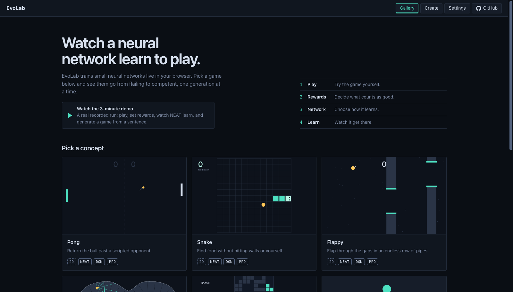
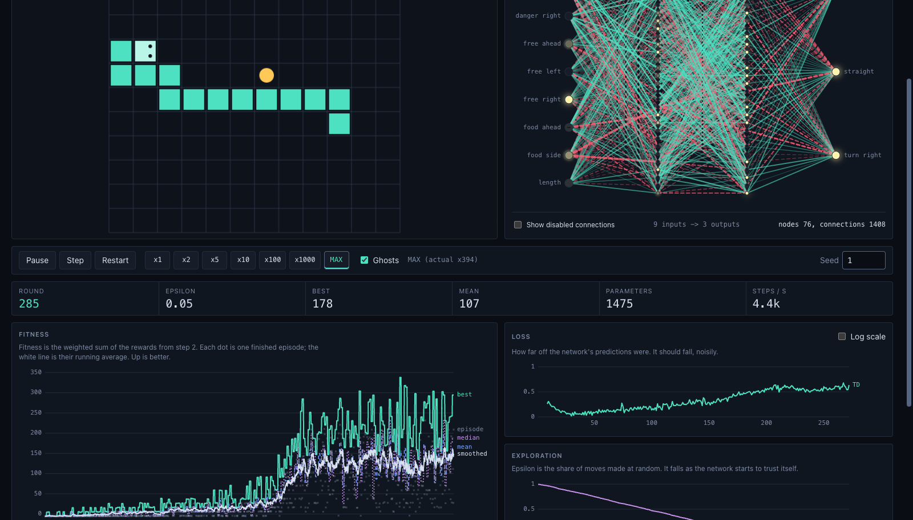
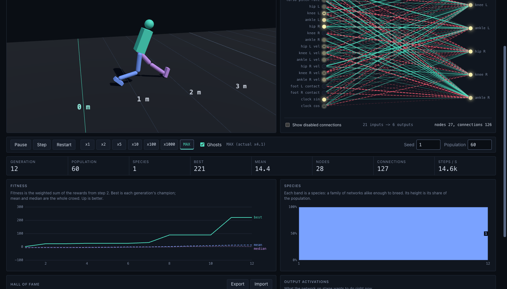
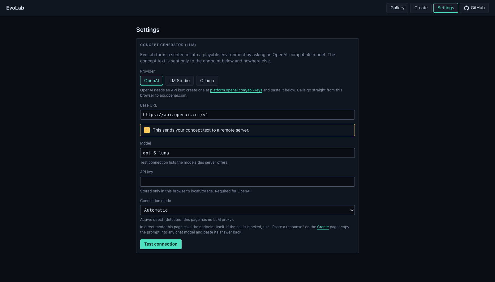
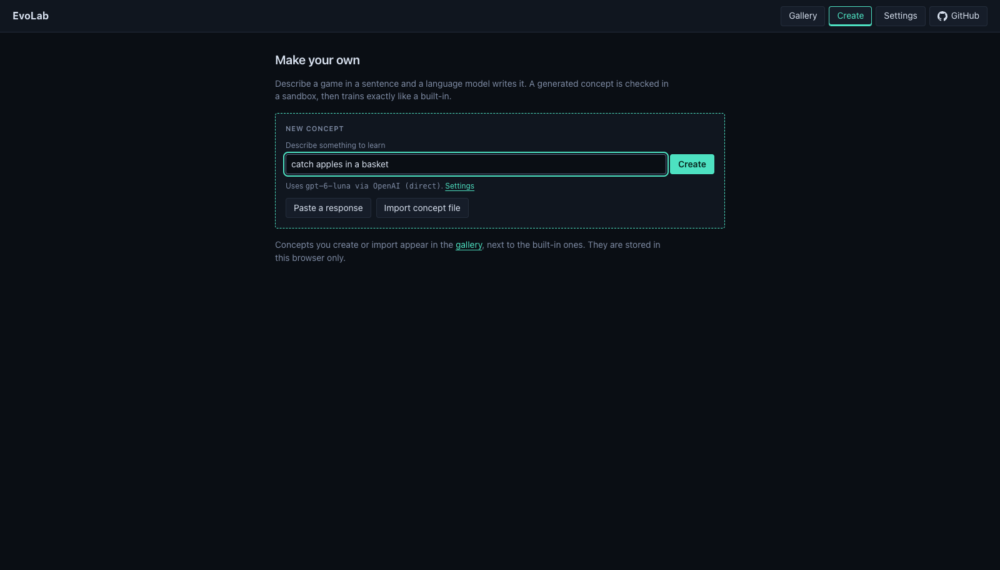
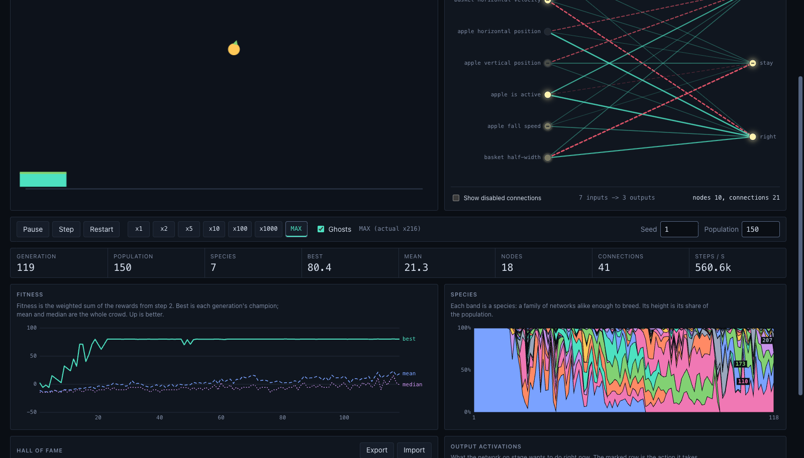

# Demo runbook

This runbook replays the demo video: a fresh browser on the live site plays Snake, sets the rewards, watches NEAT and DQN learn it, watches a 3D walker learn to walk, and has OpenAI `gpt-6-luna` write a new game from one sentence that NEAT then trains. Every screenshot and the video come from one real run on 2026-11-22 at commit `2246ccc`. Idle stretches longer than 2.5 s are shortened in the video; nothing else is cut.

Watch it: <https://laansdole.github.io/ai-please-learn/demo/> (or open `demo.html` in this folder). Time: about 6 minutes; the Create step needs about one minute for the LLM.

## 1. Prerequisites

- A desktop browser (the recording used Google Chrome, headless, 1600 x 1000).
- For step 9 only: an OpenAI API key, or a local model in LM Studio or Ollama. Nothing else is needed for steps 1 to 7.
- To run locally instead of the live site: Node 22, then `npm install` and `npm run dev` (see [DEVELOPER.md](../../../DEVELOPER.md)).

## 2. Open the app

Open <https://laansdole.github.io/ai-please-learn/>. The gallery lists six built-in games; each one goes through four steps: Play, Rewards, Network, Learn.

## 3. Play it yourself (Snake)

1. Click **Snake**. Step 1 opens with you in control and the reward table on the right.
2. Steer with the arrow keys. In the recording the snake hits the wall almost at once: fitness -5.30, "Episode over".
3. Press **R** to restart.

## 4. Set the rewards and the method

1. Click **2 Rewards**. Each term (food, approach, retreat, death, starve, survive) has a weight; the fitness is their weighted sum.
2. Click **3 Network** and keep **NEAT**.

## 5. Watch NEAT learn

1. Click **4 Learn**, then **Start**, then **MAX**.
2. Watch the stats strip, the network graph and the fitness chart.
3. Click **x1** to watch the current champion play at normal speed.

What to look for:

- Generation 131: best 253, mean 35.2, champion with 20 nodes and 51 connections.
- Generation 311: best 295, mean 70.2; the network has grown to 28 nodes and 79 connections.
- Generation 358 (at 1x): best 370, mean 62.5.
- Best and mean are per generation, so they move up and down; the trend is up.

## 6. Same game with DQN

1. Open **3 Network**, choose **DQN**, then **4 Learn**, **Start**, **MAX**.

What to look for: episode 175 best 145 and mean 78.7; episode 238 best 189 and mean 115. The network is fixed (1475 parameters) and exploration (epsilon) is already at 0.05.

## 7. The 3D walker

1. Open **3D walker**, go to **4 Learn**, **Start**, **MAX**. Then **x1** to watch the champion.

What to look for: generation 7 best 32.9 and mean 0.01 (most walkers fall over); generation 12 best 221 and mean 14.4.

## 8. Settings

1. Click **Settings**. OpenAI is the default provider with model `gpt-6-luna`; LM Studio and Ollama are the other two buttons.
2. Paste your API key. It is masked, stored only in this browser and sent only to `api.openai.com`.

## 9. Make your own game

1. Click **Create** and type a sentence. The recording used "catch apples in a basket".
2. Click **Create**. The model writes the game; the app validates it in a sandbox, including a check that random play scores clearly worse than good play.
3. The new game opens on its own page (here after 52 s) and plays like a built-in one.

## 10. Train the generated game

1. Go to **4 Learn**, **Start**, **MAX**.

What to look for: the best climbs in the first ~25 generations and then stays at 80.4 (generation 67 to 133), with the mean around 11 to 14. The network grows from 14 nodes / 29 connections to 18 / 43.

## Variance

Generated games differ from run to run. Two real runs of step 9 with the same sentence:

| Run | Time to generate | Game | NEAT result |
|---|---|---|---|
| Dry run, 13:41 | 47 s | Apple Basket (`gen-apple-basket-64a1`) | best 250 at gen 144, 248 at gen 400; mean 45.7 -> 58.9 |
| Recorded run, 13:48 | 52 s | Apple Basket (`gen-apple-basket-5f38`) | best 80.4 from ~gen 25 to gen 133; mean 13.9 -> 13.6 |

The built-in runs were also repeated in the dry run with similar numbers (Snake NEAT best 342 at gen 428; walker best 221 at gen 12).

## Troubleshooting

| Symptom | Fix |
|---|---|
| Create says it needs a key | Open Settings and paste an OpenAI key, or pick LM Studio / Ollama. |
| Ollama is not reached from the live site | Start it with `OLLAMA_ORIGINS=https://laansdole.github.io ollama serve`. |
| A generated game is gone | Generated games live only in the browser that made them. Export them from the gallery card. |

## Findings (not fixed)

- The recorded Apple Basket game reached its ceiling (80.4) within about 25 generations and stayed there; the learnability check accepts it because random play scores lower, but there is little left to learn after that.
